  <h1 align="center">Hello  I'm Aditi Gopinath</h1>

  <h3 align="center">
    B.Tech CSE student @ RV University, Bangalore
  </h3>

  <h3 align="center">
    I turn coffee and curiosity into code that solves real problems!
  </h3>

  ---

  ### Connect with Me

  🔗 LinkedIn: 

  🔗 Reach me at **aditigopinath2@gmail.com**

  ---

## GitHub Stats

<table>
  <tr>
    <td align="left" valign="top" colspan="3"></td>
    <td align="left" valign="top" colspan="3"></td>
  </tr>
</table>

## GitHub Activity

  <picture>
    <source media="(prefers-color-scheme: dark)" srcset="https://raw.githubusercontent.com/aaditiiiii1/aaditiiiii1/output/pacman-contribution-graph-dark.svg">
    <source media="(prefers-color-scheme: light)" srcset="https://raw.githubusercontent.com/aaditiiiii1/aaditiiiii1/output/pacman-contribution-graph.svg">
    
  </picture>

